# 05 — Luồng 3: Vòng đời swap slot (§9) · Luồng 5: swapon / swapoff (§11)

---

# §9. Vòng đời của một swap slot

## 9.1. Mười câu hỏi

### 1. Slot trống được quản lý thế nào?
**Không có danh sách liên kết từng slot trống.** Slot trống ⇔ `si->swap_map[offset] == 0`. Kernel tìm bằng **quét** có định hướng:
- `si->lowest_bit` … `si->highest_bit`: khoảng có thể còn slot trống (cập nhật trong `swap_range_alloc()`/`swap_range_free()` `[SOURCE mm/swapfile.c:681-741]`); `highest_bit = 0` nghĩa là area đầy.
- HDD: vị trí gợi ý `si->cluster_next`, cố cấp **liên tục** trong một "cụm" 256 slot (`cluster_nr` đếm ngược) để giảm seek (comment `:783-792`).
- SSD/eMMC (non-rotational): `cluster_info[]` với **danh sách cluster trống** `si->free_clusters` (danh sách nhúng trong mảng, `data` = chỉ số kế) + mỗi CPU một cluster hiện hành `percpu_cluster` `[SOURCE mm/swapfile.c:611-663]`.
- Ở cấp toàn hệ thống: `nr_swap_pages` (đếm slot còn có thể cấp) và plist `swap_avail_heads` chỉ chứa area **chưa đầy** `[SOURCE mm/swapfile.c:76-88]`.

### 2. Slot được cấp từ global pool hay per-CPU cache?
**Thường từ per-CPU cache** (`cache->slots[]`, nạp 64/lần từ global). **Trực tiếp từ global** (`get_swap_pages(1, ...)`) khi: cache chưa khởi tạo / CPU chưa có mảng, cache bị tắt (swap thấp, swapoff), hoặc page là THP (với THP_SWAP) `[SOURCE mm/swap_slots.c:306-347]`.

### 3. Slot được đánh dấu đang dùng ở đâu?
Đồng thời ở nhiều chỗ, **đều trong `scan_swap_map_slots()` dưới `si->lock` (+ `ci->lock`)**:
- `WRITE_ONCE(si->swap_map[offset], usage)` với `usage = SWAP_HAS_CACHE` `[SOURCE mm/swapfile.c:893, :1106]`;
- `inc_cluster_info_page()` — đếm trong cluster `[:894]`;
- `swap_range_alloc()` — `inuse_pages++`, thu hẹp `lowest_bit/highest_bit`, nếu đầy thì gỡ khỏi `swap_avail_heads` `[:897, :681-696]`;
- `nr_swap_pages` đã bị trừ **trước** khi quét (đặt chỗ), sau đó cộng lại phần không lấy được `[:1077, :1134-1137]`.

### 4. Swap entry liên kết với slot thế nào?
`slots[n_ret++] = swp_entry(si->type, offset)` `[SOURCE mm/swapfile.c:898]` — entry *chính là* (số area, số slot). Không có bảng ánh xạ entry ↔ slot; offset **là** slot.

### 5. Một slot có thể liên quan nhiều mapping không?
**Có.** Mỗi PTE (của bất kỳ process nào) trỏ tới slot đóng góp 1 vào count:
- Khi reclaim gỡ một page được N PTE map: `try_to_unmap_one()` gọi `swap_duplicate()` cho **từng** PTE `[SOURCE mm/rmap.c:1688]`.
- Khi `fork()` một process đã có swap PTE: `copy_nonpresent_pte()` gọi `swap_duplicate()` `[SOURCE mm/memory.c:715-727]`.
- shmem đánh dấu riêng `SWAP_MAP_SHMEM` (không đếm) `[SOURCE mm/swapfile.c:3541-3544]`.

### 6. Count được quản lý thế nào trong source thực tế?
1 byte: 6 bit thấp = count (tối đa `SWAP_MAP_MAX = 0x3e = 62`), bit `0x40` = `SWAP_HAS_CACHE`, bit `0x80` = `COUNT_CONTINUED` `[SOURCE include/linux/swap.h:186-196]`. Vượt 62: `__swap_duplicate()` trả `-ENOMEM` → `swap_duplicate()` gọi `add_swap_count_continuation(entry, GFP_ATOMIC)` cấp một **continuation page** lưu "chữ số" cao cho cả dải slot cùng page của `swap_map` (mỗi chữ số tối đa `SWAP_CONT_MAX = 0x7f`) `[SOURCE mm/swapfile.c:3553-3560, :3602-3718]`; cộng/trừ kiểu "999 + 1" trong `swap_count_continued()` `[:3729-3807]`. Đếm chính xác: `swp_swapcount()` `[:1566-1606]`.

### 7. Vì sao slot chưa được giải phóng ngay khi dữ liệu đã swap in?
Vì `swap_free()` chỉ giảm count; **`SWAP_HAS_CACHE` vẫn còn** khi page ở lại swap cache, và `__swap_entry_free_locked()` chỉ trả slot khi kết quả `count | has_cache == 0` `[SOURCE mm/swapfile.c:1238-1276, :1346-1360]`. Mục đích: page trong RAM vẫn có bản sao hợp lệ trên slot → reclaim lại page *sạch* không cần ghi. Ngoài ra slot có thể còn PTE khác trỏ tới (chia sẻ sau fork) — khi đó count > 0.

### 8. Điều gì xảy ra khi không còn mapping nào?
Count về 0. Hai khả năng:
- **Không có swap cache** (byte = `0x01` → 0): `__swap_entry_free_locked()` ghi tạm `SWAP_HAS_CACHE` và trả 0 → `free_swap_slot(entry)` `[SOURCE mm/swapfile.c:1270-1273, :1356-1357]`.
- **Còn swap cache** (byte = `0x41` → `0x40`): slot chưa trả. `free_swap_and_cache()` thử luôn `__try_to_reclaim_swap(..., TTRS_UNMAPPED | TTRS_FULL)`: nếu page không còn mapped (hoặc swap memcg đầy) → `try_to_free_swap()` → `delete_from_swap_cache()` → `put_swap_page()` bỏ cờ → byte = 0 → `free_swap_slot()` `[SOURCE mm/swapfile.c:1802-1825, :126-152]`. Nếu page vẫn được map (ví dụ bởi process con), slot giữ `0x40` cho tới khi page rời swap cache (`[SIM kịch bản 2 bước 5]`).

### 9. Slot về cache hay về global pool?
`free_swap_slot()`: nếu slot cache đang dùng → **per-CPU `slots_ret[]`** (khoá `free_lock`); khi `slots_ret` đầy 64 → trả cả lô; nếu cache tắt → **trả thẳng** `swapcache_free_entries(&entry, 1)` `[SOURCE mm/swap_slots.c:274-304]`. Lưu ý: slot trả về **không** được cấp lại từ `slots_ret` (cấp phát chỉ đọc `slots[]`), nó phải về global trước.

### 10. Khi nào slot có thể được cấp cho dữ liệu khác?
Chỉ sau `swapcache_free_entries()` → `swap_entry_free()`: `VM_BUG_ON(count != SWAP_HAS_CACHE)`, `swap_map[offset] = 0`, `dec_cluster_info_page()`, `mem_cgroup_uncharge_swap()`, `swap_range_free()` (`nr_swap_pages++`, có thể thêm area lại vào `swap_avail_heads`, thông báo driver `swap_slot_free_notify`, MTE invalidate, xoá shadow) `[SOURCE mm/swapfile.c:1362-1377, :710-741]`. Xảy ra khi: `slots_ret` của CPU đầy; cache bị deactivate/drain; CPU offline; swapoff. Với SSD có `SWP_PAGE_DISCARD`: nếu cluster vừa trống hoàn toàn → cả cluster bị đánh `SWAP_MAP_BAD` và đưa vào hàng discard → chỉ dùng lại sau khi `swap_do_scheduled_discard()` xong `[SOURCE mm/swapfile.c:452-541]`.

## 9.2. Bảng vòng đời

> ⚠️ `[MÔ HÌNH GIẢI THÍCH]` — các "trạng thái" S0…S8 dưới đây do tài liệu tổng hợp để dễ hiểu. Kernel **không** có enum này; trạng thái thật chỉ là **giá trị byte `swap_map`** cộng với ngữ cảnh (page có ở swap cache không, slot có nằm trong mảng per-CPU nào không). Chú ý: **S1, S2, S6, S7 có cùng byte `0x40`** — chỉ nhìn `swap_map` không phân biệt được.

| Trạng thái | Ý nghĩa | Dữ liệu được quản lý ở đâu | Điều kiện chuyển | Function liên quan |
|---|---|---|---|---|
| **S0 Trống** (`0x00`) | chưa ai dùng | `swap_map`, nằm trong `[lowest_bit, highest_bit]`; được tính trong `nr_swap_pages` | cấp phát quét thấy → S1 (qua cache) hoặc S2 (cấp trực tiếp) | `scan_swap_map_slots()`, `get_swap_pages()` |
| **S1 Trong túi per-CPU** (`0x40`) | đã đặt chỗ, chưa gán page | `per_cpu(swp_slots).slots[]`; đã trừ khỏi `nr_swap_pages` | `get_swap_page()` lấy ra → S2; drain/swapoff/CPU offline → S0 | `refill_swap_slots_cache()`, `drain_slots_cache_cpu()` |
| **S2 Gán cho page, chưa có PTE** (`0x40`) | page vào swap cache, PTE vẫn present | `swap_map` + xarray swap cache + `page->private` | `try_to_unmap` → S3; `add_to_swap` thất bại → `put_swap_page` → S7/S0 | `add_to_swap()`, `add_to_swap_cache()` |
| **S3 Đang swap out** (`0x40 + N`) | N PTE là swap PTE, page còn trong RAM (có thể đang writeback) | `swap_map` (count N + cache), swap PTE trong page table | reclaim free frame → S4; process chạm lại → vẫn S3 nhưng count giảm (map lại) | `swap_duplicate()`, `swap_writepage()` |
| **S4 Đã swap out** (`0x00 + N`, N ≥ 1) | dữ liệu **chỉ** trên slot | swap PTE (N cái) + `swap_map`; `swap_cgroup` ID | fault → `swapcache_prepare` → S5; munmap/exit các PTE → count giảm; về 0 → S7/S0 | `__remove_mapping()` + `put_swap_page()`; `free_swap_and_cache()` |
| **S5 Đang/đã đọc về** (`0x40 + N`) | page mới trong swap cache, PTE còn swap PTE cho tới khi fault map lại | `swap_map`, swap cache | mỗi PTE map lại → `swap_free` → count giảm; về 0 → S6 | `__read_swap_cache_async()`, `do_swap_page()` |
| **S6 Chỉ còn cache** (`0x40`, count 0) | page trong RAM, mọi PTE đã là PTE thường; slot giữ bản sao | `swap_map` + swap cache | page bị reclaim lại sạch → `swap_duplicate` từ unmap → S3 (không cần ghi); page rời swap cache (`try_to_free_swap`, `reuse_swap_page`, swap đầy) → S7/S0 | `try_to_free_swap()`, `delete_from_swap_cache()` |
| **S7 Đã trả, chờ trong `slots_ret`** (`0x40`) | không còn ai dùng, nhưng chưa về pool | `per_cpu(swp_slots).slots_ret[]` | `slots_ret` đầy / drain / CPU offline → S0 (hoặc S8) | `free_swap_slot()`, `swapcache_free_entries()` |
| **S8 Đang discard** (`0x3f` cả cluster) | SSD: cluster trống đang được TRIM | `si->discard_clusters` | `swap_do_scheduled_discard()` xong → S0 | `swap_cluster_schedule_discard()`, `swap_discard_work()` |

Chuỗi điển hình (mô phỏng `[SIM tools/swap_map_sim.out.txt kịch bản 1]`):
`S0 →(refill) S1 →(get_swap_page) S2 →(unmap) S3 →(remove_mapping) S4 →(fault) S5 →(swap_free) S6 →(reclaim lại, sạch) S3 → S4 →(exit) S7 →(drain) S0`

## Sơ đồ 5 — Flowchart: cấp phát và giải phóng swap slot

**Cách đọc:** nửa trên = đường **cấp**; nửa dưới = đường **giảm tham chiếu / trả**. Khối có số dòng nguồn là function thật. Hình thoi là điều kiện thật trong code.

```mermaid
flowchart TD
    subgraph ALLOC["Đường cấp phát"]
        GSP(["get_swap_page<br/>swap_slots.c:306"]) --> ACT{"check_cache_active<br/>và cache có mảng slots?"}
        ACT -->|"có"| ML["mutex_lock alloc_lock"]
        ML --> HAS{"cache còn nr lớn hơn 0?"}
        HAS -->|"có"| TAKE["lấy slots cur, nr giảm"]
        HAS -->|"không"| REF["refill: get_swap_pages 64"]
        REF -->|"lấy được"| TAKE
        REF -->|"0 slot"| DIRECT
        ACT -->|"không"| DIRECT["get_swap_pages 1 trực tiếp"]
        DIRECT --> GSPS
        REF --> GSPS["get_swap_pages: trừ trước nr_swap_pages,<br/>duyệt swap_avail_heads theo priority"]
        GSPS --> SCAN["scan_swap_map_slots dưới si->lock:<br/>tìm byte 0, ghi SWAP_HAS_CACHE,<br/>cluster count, inuse_pages"]
        TAKE --> CHG{"mem_cgroup_try_charge_swap OK?"}
        DIRECT -->|"có entry"| CHG
        DIRECT -->|"không có"| NOSLOT(["entry 0: add_to_swap thất bại"])
        CHG -->|"không"| PUT0["put_swap_page, trả entry 0"]
        CHG -->|"có"| GOT(["entry hợp lệ, byte bằng 0x40"])
    end

    subgraph FREE["Đường giảm tham chiếu và trả slot"]
        DEC1(["swap_free hoặc free_swap_and_cache:<br/>count giảm 1"]) --> Z{"count bằng 0 và không HAS_CACHE?"}
        DEC2(["put_swap_page:<br/>bỏ HAS_CACHE"]) --> Z
        Z -->|"không"| STAY(["slot còn dùng"])
        Z -->|"có"| TMP["ghi tạm SWAP_HAS_CACHE<br/>gọi free_swap_slot"]
        TMP --> CA{"slot cache đang dùng?"}
        CA -->|"không"| SFE["swapcache_free_entries 1 slot"]
        CA -->|"có"| FULL{"slots_ret đã đủ 64?"}
        FULL -->|"có"| FLUSH["swapcache_free_entries cả lô"]
        FLUSH --> PUSH["thêm vào slots_ret"]
        FULL -->|"không"| PUSH
        PUSH -.->|"sau này: đầy, drain, CPU offline"| SFE
        SFE --> SEF["swap_entry_free: byte bằng 0,<br/>uncharge memcg, swap_range_free"]
        SEF --> DIS{"SSD và cluster vừa trống<br/>và SWP_PAGE_DISCARD?"}
        DIS -->|"có"| DISC["cluster bị đánh BAD, chờ discard"]
        DIS -->|"không"| S0(["slot trống, cấp lại được"])
        DISC --> S0
    end
```



**Giải thích:**
- `check_cache_active()` bật/tắt theo ngưỡng (`[SIM §2]`: 4 CPU → tắt < 512, bật > 1280).
- `alloc_lock` là **mutex** vì `refill` có thể ngủ.
- `get_swap_pages()` đặt chỗ trên `nr_swap_pages` trước rồi quét; `scan_swap_map_slots()` là nơi duy nhất ghi byte từ 0 → `0x40`.
- `mem_cgroup_try_charge_swap()` có thể từ chối (memcg v2 vượt `swap.max`) → slot bị trả ngay.
- Đường giảm: `swap_free`/`free_swap_and_cache` giảm count; `put_swap_page` bỏ cờ cache; chỉ khi **cả hai** về 0 thì slot mới đi qua `free_swap_slot()`.
- Slot trong `slots_ret` **vẫn mang `0x40`** → không thể bị cấp nhầm (nét đứt = xảy ra muộn).
- `swap_entry_free()` là nơi duy nhất đưa byte `0x40 → 0x00`.

---

# §11. Luồng 5: swapon và swapoff

## 11.1. Swapon — góc nhìn quản trị viên

```sh
mkswap /dev/mmcblk0p9          # ghi swap header: "SWAPSPACE2", version 1, last_page, bad pages
swapon -p 10 /dev/mmcblk0p9    # priority 10 (SWAP_FLAG_PREFER), có thể --discard
cat /proc/swaps                # Filename  Type  Size  Used  Priority
```
`[KIẾN THỨC NỀN]` cho lệnh userspace; định dạng `/proc/swaps` `[SOURCE mm/swapfile.c:2825-2850]`, cờ swapon `[SOURCE include/linux/swap.h:23-32]`.

## 11.2. Swapon — kernel làm gì (`SYSCALL_DEFINE2(swapon)` `[SOURCE mm/swapfile.c:3182-3443]`)

| # | Bước | Dòng | Metadata dựng ra |
|---|---|---|---|
| 1 | Kiểm tra cờ, `CAP_SYS_ADMIN`, `swap_avail_heads` đã khởi tạo | `:3201-3208` | |
| 2 | `alloc_swap_info()`: tìm chỉ số `type` trống trong `swap_info[]` (tối đa `MAX_SWAPFILES`), `flags = SWP_USED` | `:3210`, `:2899-2949` | `swap_info_struct` |
| 3 | Mở file/thiết bị; `claim_swapfile()`: block device → mở độc quyền, `set_blocksize(PAGE_SIZE)`, cấm zoned device, `SWP_BLKDEV` | `:3222-3235`, `:2951-2980` | |
| 4 | `inode_lock`; file đang là swap rồi? → `-EBUSY` | `:3237-3241` | |
| 5 | Đọc page 0 (header), `read_swap_header()`: kiểm tra `"SWAPSPACE2"`, version 1, `last_page`, giới hạn `max_swapfile_size()`, kích thước file, bad pages → **`maxpages`**; đặt `lowest_bit = 1`, `highest_bit = maxpages - 1` | `:3250-3261`, `:3011-3078` | |
| 6 | `swap_map = vzalloc(maxpages)` — 1 byte/slot | `:3264` | **swap_map** |
| 7 | Cờ thiết bị: `SWP_STABLE_WRITES`, `SWP_SYNCHRONOUS_IO` (có `rw_page`) | `:3270-3274` | |
| 8 | Non-rotational: `SWP_SOLIDSTATE`, `cluster_next_cpu` per-CPU ngẫu nhiên (wear leveling), `cluster_info` + lock từng cluster, `percpu_cluster`; ngược lại `nr_rotate_swap++` | `:3276-3319` | **cluster_info**, percpu |
| 9 | `swap_cgroup_swapon(type, maxpages)` | `:3321` | **swap_cgroup map** |
| 10 | `setup_swap_map_and_extents()`: đánh `SWAP_MAP_BAD` cho bad page và slot 0 (header), tính `p->pages = maxpages - 1 - bad`, dựng **swap extent** (`setup_swap_extents()`), xây `free_clusters` (xếp xen kẽ cột để giảm false sharing) | `:3325`, `:3087-3166` | **extents**, danh sách cluster |
| 11 | (frontswap map — tắt) ; discard: nếu `SWAP_FLAG_DISCARD` và thiết bị hỗ trợ → `SWP_DISCARDABLE/AREA/PAGE_DISCARD`, có thể `discard_swap()` toàn bộ area | `:3332-3365` | |
| 12 | `init_swap_address_space(type, maxpages)` | `:3367` | **swapper_spaces[type]** (swap cache) |
| 13 | `S_SWAPFILE` trên inode (cấm ghi từ userspace), `inode_drain_writes()` | `:3375-3380` | |
| 14 | `enable_swap_info()` dưới `swapon_mutex`: `setup_swap_info()` (priority: không chỉ định → `--least_priority` âm), **`synchronize_rcu()`**, rồi `_enable_swap_info()`: `SWP_WRITEOK \| SWP_VALID`, `nr_swap_pages += pages`, `total_swap_pages += pages`, thêm vào `swap_active_head` và `swap_avail_heads` | `:3382-3387`, `:2488-2559` | area **sẵn sàng cấp slot** |
| 15 | Log `"Adding %uk swap on %s. Priority:%d extents:%d across:%lluk SS D s c FS"` | `:3389-3396` | |
| 16 | `enable_swap_slots_cache()` (lần đầu: đăng ký hotplug, cấp mảng per-CPU) | `:3440-3441` | **per-CPU slot cache** |
| — | Lỗi ở bất kỳ bước nào → nhãn `bad_swap*`: huỷ ngược mọi thứ đã dựng, `swap_cgroup_swapoff()`, `flags = 0` | `:3404-3430` | |

**Kernel biết số slot thế nào?** `maxpages` = `min(last_page + 1, max_swapfile_size())`, kiểm tra không vượt kích thước file `[:3046-3071]`; `p->pages` = `maxpages − 1 (header) − bad pages` `[:3101-3133]`; với swap file, `generic_swapfile_activate()` có thể giảm thêm nếu block không liên tục/không căn page `[SOURCE mm/page_io.c:116-185]`. Ví dụ 2 GiB → `max = 524288`, `pages = 524287` `[SIM §1]`.

**Nhiều vùng swap được quản lý thế nào?** Mỗi vùng một `type` và một priority. Cấp phát duyệt `swap_avail_heads` từ priority cao nhất; `plist_requeue()` đưa area vừa dùng ra sau các area **cùng priority** → round-robin `[SOURCE mm/swapfile.c:1081-1083]`. Area đầy bị gỡ khỏi avail list (`swap_range_alloc` `:691-695`), có chỗ lại thì được thêm vào (`swap_range_free` `:719-725`).

**Khi nào bắt đầu cấp slot được?** Ngay sau `_enable_swap_info()` đặt `SWP_WRITEOK` và đưa vào avail list (bước 14). `synchronize_rcu()` trước đó bảo đảm ai thấy `SWP_VALID` thì cũng thấy `swap_map`/`cluster_info` hợp lệ (comment `:2549-2553`).

## 11.3. Swapoff — góc nhìn quản trị viên

`swapoff /dev/mmcblk0p9`. Lệnh có thể **chạy rất lâu** (đọc lại toàn bộ dữ liệu đang ở swap), có thể **thất bại** (`ENOMEM` nếu không đủ bộ nhớ, `EINTR` nếu bị signal), và trong lúc chạy hệ thống chịu áp lực bộ nhớ lớn.

**Vì sao không thể ngừng dùng thiết bị ngay?** Vì các swap PTE trong page table của mọi process đang trỏ vào area này, và **dữ liệu đó chỉ tồn tại trên thiết bị**. Gỡ thiết bị trước khi đọc về = mất dữ liệu của process (fault sau đó sẽ gặp entry không hợp lệ → `"Bad swap file entry"`, SIGBUS).

## 11.4. Swapoff — kernel làm gì (`SYSCALL_DEFINE1(swapoff)` `[SOURCE mm/swapfile.c:2582-2761]`)

| # | Bước | Dòng | Ý nghĩa |
|---|---|---|---|
| 1 | `CAP_SYS_ADMIN`; tìm area theo `f_mapping` trong `swap_active_head` (phải `SWP_WRITEOK`) | `:2595-2623` | |
| 2 | `security_vm_enough_memory_mm(current->mm, p->pages)` — đủ "chỗ" commit để nhận lại `p->pages` page? Không → `-ENOMEM` ngay | `:2624-2630` | từ chối sớm theo chính sách overcommit |
| 3 | `del_from_avail_list()`, điều chỉnh priority âm của các area sau, `plist_del` khỏi active, `nr_swap_pages -= pages`, `total_swap_pages -= pages`, **xoá `SWP_WRITEOK`** | `:2631-2652` | **không cấp slot mới** từ area này nữa |
| 4 | `disable_swap_slots_cache_lock()`: giữ `swap_slots_cache_enable_mutex`, tắt cache, **drain mọi CPU** (trả slot trong `slots[]`/`slots_ret[]` về pool) | `:2654` | không để slot của area "trốn" trong túi CPU |
| 5 | `set_current_oom_origin()` → `try_to_unuse(type, false, 0)` → `clear_current_oom_origin()` | `:2656-2658` | đọc mọi thứ về; task swapoff là ứng viên OOM ưu tiên |
| 6 | Lỗi → `reinsert_swap_info()` + `reenable_swap_slots_cache_unlock()`, trả lỗi | `:2660-2665` | area hoạt động lại như cũ |
| 7 | `reenable_swap_slots_cache_unlock()` | `:2667` | |
| 8 | Xoá **`SWP_VALID`**, `synchronize_rcu()` (chờ mọi `get_swap_device()` đang chạy), `flush_work(discard_work)`, `destroy_swap_extents()`, free continuation, `nr_rotate_swap--` | `:2669-2687` | không còn ai đang đọc metadata |
| 9 | `swapon_mutex` + `swap_lock` + `p->lock`: `drain_mmlist()` (nếu không còn area nào dùng); `highest_bit = 0` cắt ngắn mọi lần quét; **chờ `SWP_SCANNING` về 0** (`schedule_timeout_uninterruptible(1)`) | `:2689-2702` | không còn ai đang quét `swap_map` |
| 10 | Tháo `swap_file`, `swap_map`, `cluster_info`, `max = 0`; free percpu, `vfree(swap_map)`, `kvfree(cluster_info)` | `:2704-2725` | |
| 11 | `swap_cgroup_swapoff(type)`, `exit_swap_address_space(type)` | `:2727-2728` | metadata `swap_cgroup.c`, `swap_state.c` |
| 12 | Trả block size, `blkdev_put`, bỏ `S_SWAPFILE`, `filp_close`; **cuối cùng** `p->flags = 0` (xoá `SWP_USED`) để swapon sau có thể dùng lại slot `swap_info[type]` | `:2730-2750` | |

### `try_to_unuse()` chi tiết `[SOURCE mm/swapfile.c:2190-2296]`
1. `shmem_unuse()` — trước hết đưa page shmem/tmpfs về `:2209`.
2. Duyệt **`init_mm.mmlist`** (mọi mm từng có swap PTE — được thêm trong `try_to_unmap_one()` `rmap.c:1700-1705` và `fork` `memory.c:719-726`): `unuse_mm()` → mọi VMA có `anon_vma` → `unuse_vma/p4d/pud/pmd/pte_range()` `:2134-2152, :1972-2131`.
3. Với mỗi swap PTE thuộc `type`: `lookup_swap_cache()` hoặc `swapin_readahead()` (**cấp page + đọc I/O**) → `lock_page`, `wait_on_page_writeback` → `unuse_pte()`: dưới PTE lock, nếu PTE còn đúng là swap PTE đó → đặt PTE present (`pte_mkold`, chưa ghi được → COW nếu cần sau), rmap, `swap_free(entry)` `:1932-1970` → `try_to_free_swap(page)` `:2026`.
4. Không đọc được page mà slot vẫn dùng → `-ENOMEM` `:2011-2015` → swapoff thất bại.
5. Vòng thứ hai: `find_next_to_unuse()` quét `swap_map` tìm slot còn dùng; với slot có page trong swap cache → `try_to_free_swap()` `:2246-2275`.
6. Còn `inuse_pages` → **lặp lại từ đầu** (không giới hạn số lần — comment `:2277-2288`: dưới áp lực, entry có thể bị đưa ngược vào process sau khi vòng mmlist đã đi qua); signal → `-EINTR`.

### Vai trò của `swap_slots.c` trong swapoff
`disable_swap_slots_cache_lock()` tắt cache + drain ⇒ (a) slot của area sắp gỡ nằm trong túi CPU được trả về và `inuse_pages` có thể về 0; (b) trong suốt `try_to_unuse()`, mọi `free_swap_slot()` trả thẳng về pool (cache tắt) → `inuse_pages` giảm ngay. Cũng vì cache tắt, `__read_swap_cache_async()` không được coi "count = 0 → bỏ qua" là chắc chắn: điều kiện `!__swp_swapcount(entry) && swap_slot_cache_enabled` `[SOURCE mm/swap_state.c:478-486]` — comment giải thích đua giữa "đưa entry vào swap cache" và "đánh dấu `SWAP_HAS_CACHE`" khi cache bị tắt trong swapoff.

### Nếu RAM không đủ để đưa dữ liệu về?
- Mỗi page đọc về cần một frame (`alloc_page_vma` trong readahead) → có thể kích hoạt **reclaim**. Area đang gỡ đã mất `SWP_WRITEOK`, nên anon page chỉ có thể bị swap ra **area khác** (nếu có) hoặc không thể swap.
- Nếu reclaim không đủ → OOM killer; `set_current_oom_origin()` làm chính task `swapoff` bị ưu tiên kill `[SOURCE mm/swapfile.c:2656; KIẾN THỨC NỀN về cách oom_badness dùng oom_origin]`.
- Không cấp được page cho một entry còn dùng → `try_to_unuse()` trả `-ENOMEM` → swapoff **hoàn tác** (`reinsert_swap_info`), area dùng tiếp `[SOURCE mm/swapfile.c:2660-2665]`.
- Bước 2 (`security_vm_enough_memory_mm`) chỉ là kiểm tra commit, **không bảo đảm** đủ RAM vật lý.

### Kernel có phải chờ I/O hoặc reclaim không?
Có, ở nhiều chỗ đã thấy trong code: đọc I/O + `lock_page()` (chờ I/O đọc), `wait_on_page_writeback()` `:2018, :2263`, reclaim trong cấp phát, `synchronize_rcu()` `:2678`, `flush_work(&p->discard_work)` `:2680`, vòng chờ `SWP_SCANNING` `:2696-2702`, `cond_resched()` trong mọi vòng duyệt.

## Sơ đồ 7 — Flowchart: swapon và swapoff

**Cách đọc:** hai subgraph độc lập. Nhánh "lỗi" của swapon gom về một khối huỷ ngược; nhánh "lỗi" của swapoff dẫn về "hoàn tác, area dùng tiếp".

```mermaid
flowchart TD
    subgraph ON["swapon"]
        A1(["swapon path, flags"]) --> A2["alloc_swap_info: chọn type, SWP_USED"]
        A2 --> A3["mở file, claim_swapfile"]
        A3 --> A4{"đọc header SWAPSPACE2 hợp lệ?"}
        A4 -->|"không"| AERR["bad_swap: huỷ ngược mọi metadata"]
        A4 -->|"có, có maxpages"| A5["vzalloc swap_map"]
        A5 --> A6{"thiết bị non-rotational?"}
        A6 -->|"có"| A7["cluster_info, percpu_cluster,<br/>SWP_SOLIDSTATE"]
        A6 -->|"không"| A8["nr_rotate_swap tăng"]
        A7 --> A9
        A8 --> A9["swap_cgroup_swapon"]
        A9 --> A10["setup_swap_map_and_extents:<br/>slot 0 và bad page bằng BAD, extent, free_clusters"]
        A10 --> A11["init_swap_address_space: swap cache"]
        A11 --> A12["enable_swap_info: synchronize_rcu,<br/>SWP_WRITEOK và SWP_VALID, nr_swap_pages tăng"]
        A12 --> A13(["enable_swap_slots_cache: bắt đầu cấp slot"])
        A5 -->|"hết bộ nhớ"| AERR
        A9 -->|"hết bộ nhớ"| AERR
        A10 -->|"lỗi extent"| AERR
        A11 -->|"hết bộ nhớ"| AERR
    end

    subgraph OFF["swapoff"]
        B1(["swapoff path"]) --> B2{"tìm thấy area và<br/>vm_enough_memory OK?"}
        B2 -->|"không"| BERR0(["EINVAL hoặc ENOMEM"])
        B2 -->|"có"| B3["gỡ khỏi avail list, nr_swap_pages giảm,<br/>xoá SWP_WRITEOK"]
        B3 --> B4["disable_swap_slots_cache_lock: drain mọi CPU"]
        B4 --> B5["try_to_unuse: shmem_unuse, duyệt mmlist,<br/>đọc từng page về, unuse_pte, swap_free"]
        B5 --> B6{"còn inuse_pages?"}
        B6 -->|"có, không signal"| B5
        B6 -->|"signal hoặc ENOMEM"| BERR["reinsert_swap_info,<br/>bật lại slot cache: hoàn tác"]
        B6 -->|"không"| B7["xoá SWP_VALID, synchronize_rcu,<br/>flush discard, huỷ extent"]
        B7 --> B8["highest_bit bằng 0, chờ SWP_SCANNING"]
        B8 --> B9["free swap_map, cluster_info,<br/>swap_cgroup_swapoff, exit_swap_address_space"]
        B9 --> B10(["đóng file, flags bằng 0"])
    end
```



**Giải thích:** swapon dựng metadata theo thứ tự `swap_map` → cluster → `swap_cgroup` → extent → swap cache → bật cờ; chỉ ở **bước cuối** area mới cấp slot được. swapoff làm ngược lại nhưng phải **đọc hết dữ liệu về trước** (vòng `B5–B6`, có thể lặp nhiều lần), và chỉ huỷ metadata sau khi đã chắc không còn ai dùng (RCU, `SWP_SCANNING`).

## 11.5. Tóm tắt
- swapon: header → `maxpages` → `swap_map` (+cluster) → `swap_cgroup` → extent → swap cache → `SWP_WRITEOK|SWP_VALID` → slot cache.
- swapoff: chặn cấp mới → drain slot cache → `try_to_unuse()` đọc mọi page về (có thể lâu, có thể ENOMEM/EINTR và hoàn tác) → chờ mọi người dùng metadata xong → huỷ.
- Slot = byte trong `swap_map`; về 0 chỉ qua `swap_entry_free()`; giữa "không ai dùng" và "trống thật" có thể có độ trễ do per-CPU `slots_ret`.
